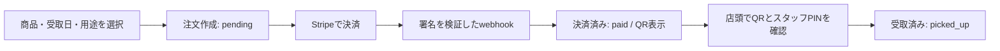

# パン店向け LINE 事前注文・店頭受け取り

## 概要

LINEのメッセージから注文画面へ進み、商品と受取日を選んで事前決済し、店頭でQRコードを提示する試作です。贈る用途と自分用の注文を選べます。大学院の企業連携PBLでは、LINEを起点としたOMO（ネットと店舗の連携）の仕組みと購買データの活用を研究しています。このリポジトリは、そのPBLとは別に、パン店へ企画から提案まで自主的に進めた版です。

## 背景と設計理由

対象としたパン店にはECがなく、パンは生もので配送しにくいため、ギフトも配送より店頭受け取りに寄せました。自分用には、来店前に注文と支払いを済ませるモバイルオーダー型の使い方を加えました。

ギフト向けの注文基盤から、パン店向けに特に次の3点を調整しました。

| 調整した点 | 理由 |
| --- | --- |
| 受取日を注文時に指定 | 生ものを店頭で渡す日を決めるため |
| 決済確定をStripeのwebhookで注文に反映 | 画面上の支払い操作だけで受け取り可能にしないため |
| 決済後にQRを表示し、店頭で受け取りを確認 | 配送せず、店頭で渡した記録を残すため |

お店の手数料に対する懸念には、新しい客層との接点、先払いによる未受取の損失抑制、限定品の売り切りを見合う効果として提案しました。いずれも実証前の仮説であり、成果として検証済みではありません。

## 本人の役割と現在の段階

企画から提案まで担当しました。実装の多くはAIエージェント（Claude Code・Codex）を活用しました。現在は実店舗での実証に向けて最終調整中です。この公開リポジトリに管理画面や毎朝のまとめメールの実装は含まれていません。

## 注文から受け取りまで

未払いの注文にはQRを表示しません。受取確定は、QRのトークン、スタッフPIN、決済済み状態、指定した受取日が当日であることを条件に更新します。決済通知は注文IDだけでは更新せず、Stripe署名、決済ID、金額、未払い状態も照合します。

## データの設計と構成

- `products`：商品ID、名前、説明、金額、公開状態。
- `orders`：商品・価格の注文時点の控え、受取日、用途（`self` / `gift`）、Stripe決済ID、状態、受取日時。
- 注文ID、注文照会用の`access_token`、店頭受取用の`qr_token`は別々のランダムな値です。注文画面の照会には`access_token`、QRの確認画面には`qr_token`を使います。過去の注文は用途が未設定のまま保持します。
- `public/`は注文・受取確認画面、`api/`は注文・Stripe/LINE webhook、`lib/`は外部サービス接続、`migrations/schema.sql`はテーブル定義です。

Node.js / Express、Supabase（PostgreSQL）、Stripe、LINE Messaging API、Vercelを使用します。LINE webhookは注文画面への案内を返します。LIFFはこの版では使用していません。

## セットアップ

1. Node.jsと依存パッケージを用意し、`.env.example`を参考にローカルの`.env`またはホスティング環境へ設定値を登録します。実際の鍵・IDは公開しません。
2. SupabaseのSQLエディタで`migrations/schema.sql`を適用します。既存の`orders`にも注文照会用トークン列が追加されます。必要なら`node scripts/seed-products.js`でダミー商品を登録します。
3. Vercel環境では`vercel dev`で起動します。Stripeの決済通知先は`/stripe-webhook`、LINEのwebhook先は`/webhook`です。Stripe webhookでは`payment_intent.succeeded`を受け取ります。

| 環境変数 | 用途 |
| --- | --- |
| `BASE_URL` | 公開する注文画面と受取確認画面のベースURL |
| `LINE_CHANNEL_ACCESS_TOKEN`, `LINE_CHANNEL_SECRET` | LINE返信と署名検証 |
| `STRIPE_PUBLISHABLE_KEY`, `STRIPE_SECRET_KEY`, `STRIPE_WEBHOOK_SECRET` | 決済画面、決済作成、通知の署名検証 |
| `SUPABASE_URL`, `SUPABASE_SERVICE_ROLE_KEY` | サーバー側のDB接続 |
| `STAFF_PIN` | 店頭受取の確定時に入力するスタッフ用PIN |

`SUPABASE_SERVICE_ROLE_KEY`と`STAFF_PIN`はサーバー側だけに設定します。既存の決済が進行中でも通知を処理できるよう、旧メタデータ`giftType=gift`は受け付けます。旧URLに注文IDだけを保存した注文画面は、安全性のため照会できなくなります。

## 今後

実店舗で注文・決済・受け取りの一連の動作を確かめ、受取日や店側の運用負荷、提案した効果を検証します。ギフトの受取用QRを相手へ自動送信する機能は、この公開版にはありません。管理画面と毎朝のまとめメールも実装されていないため、ここでは動作確認の対象外です。店頭運用前には、共有PINの試行制限やスタッフごとの権限管理も検討します。
